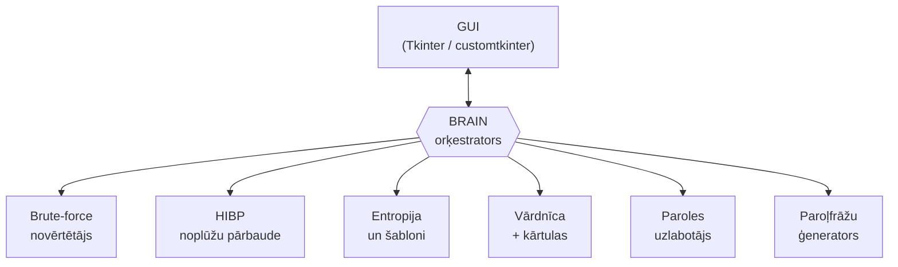
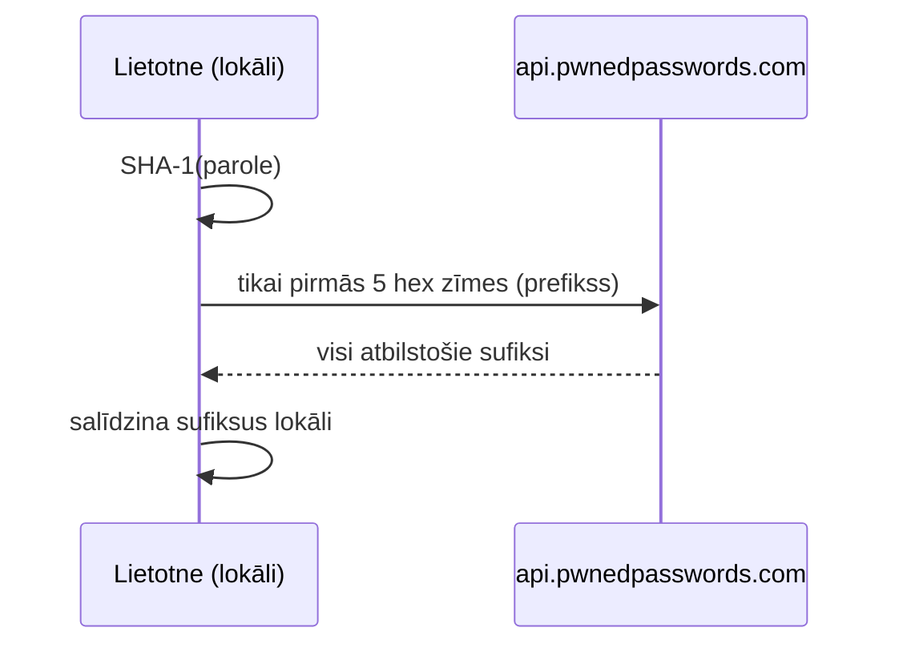
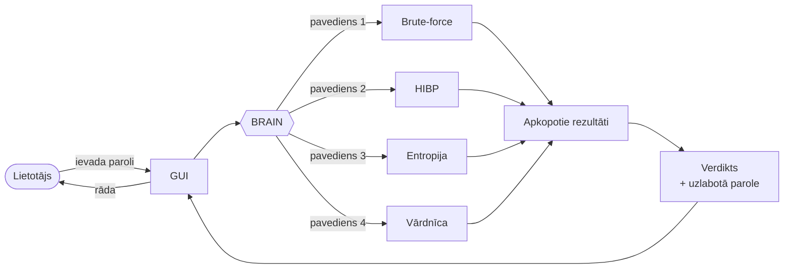

# Paroļu drošības analizators

> Universitātes programmatūras projekts · tehnisks priekšlikums

Darbvirsmas lietotne (Python + grafiskā saskarne), kas **pārbauda paroles drošību vairākos neatkarīgos veidos** un pēc tam **iesaka stiprāku variantu**.

Galvenā ideja: **garums vien nenosaka drošību.** Bieža, paredzama parole krīt milisekundēs, bet gara nejauša paroļfrāze pretojas gadsimtiem.

---

## Saturs

1. [Mērķi un tvērums](#1-mērķi-un-tvērums)
2. [Arhitektūra](#2-arhitektūra)
3. [Moduļi](#3-moduļi)
4. [Datu plūsma](#4-datu-plūsma)
5. [Kāpēc tas nav triviāli](#5-kāpēc-tas-nav-triviāli)
6. [Testēšanas plāns](#6-testēšanas-plāns)
7. [Riski un ierobežojumi](#7-riski-un-ierobežojumi)
8. [Grafiks](#8-grafiks)

---

## 1. Mērķi un tvērums

**Mērķi**

- Novērtēt paroli pēc vairākiem neatkarīgiem kritērijiem un apvienot tos vienā saprotamā verdiktā.
- Pārbaudīt, vai parole ir parādījusies datu noplūdēs, **neatklājot pašu paroli**.
- Ģenerēt stiprāku paroli vai paroļfrāzi un **pierādīt uzlabojumu** ar pašu uzlaušanas rīku.
- Izglītot lietotāju: parādīt atšķirību starp garumu un paredzamību.

| Tvērumā | Ārpus tvēruma |
|---|---|
| 7 moduļi (skat. [3. sadaļu](#3-moduļi)) | Tiešsaistes / servera versija |
| GUI | Paroļu glabātuve |
| Vienību testi | Vairāku valodu atbalsts |
| | Reāla GPU uzlaušanas ātruma mērīšana uz specializētas aparatūras |

---

## 2. Arhitektūra

Zvaigznes veida (*hub-and-spoke*) arhitektūra. **BRAIN** ir vienīgā vieta, kas pazīst visus moduļus. Katrs modulis ir neatkarīgs: saņem paroli (vai tās atvasinājumu) un atgriež strukturētu rezultātu. Tāpēc pārbaudi var pievienot vai nomainīt, neskarot pārējās.



---

## 3. Moduļi

### 3.1. Brute-force novērtētājs

Balstīts uz esošo `brute_force.py`, kas ar `itertools.product` izsmeļoši pārlasa visu atslēgtelpu, līdz atrod paroli. Garākām par ~7 zīmēm tas **nekad nepabeidzas**, tāpēc to pārraksta:

1. uz nelielas zināmas atslēgtelpas **izmēra ātrumu** (minējumi sekundē);
2. analītiski ekstrapolē:

```
laiks ≈ atslēgtelpas izmērs ÷ minējumu ātrums
```

Rezultāts ir **novērtējums**, nevis izmērīts reāls uzlaušanas laiks.

### 3.2. HIBP noplūžu pārbaude (k-anonimitāte)



Pati parole un pilnais hash **nekad nepamet datoru**. To nodrošina k-anonimitātes dizains.

### 3.3. Entropijas un šablonu analīze

Aprēķina Šenona / zīmju kopas entropiju un atsevišķi atklāj paredzamus šablonus:

- klaviatūras gājieni
- atkārtojumi un secības
- datumi
- vārdnīcas vārdi ar leet aizvietojumiem

Zema entropija vai atrasts šablons **pazemina verdiktu pat garai parolei**.

### 3.4. Vārdnīcas + kārtulu uzbrukums

Modelē reālu uzbrucēju: vārdnīca + transformāciju kārtulas (leet, galotnes, gadi). Rāda blakus tīram brute-force, lai parādītu, ka bieža parole krīt milisekundēs, bet tīrs brute-force prasītu gadsimtus.

### 3.5. Paroles uzlabotājs

Ģenerē stiprāku esošās paroles variantu. Naivs leet aizvietojums (`a→@`, `o→0`) gandrīz nepalīdz, jo uzbrucēju kārtulas to jau ietver. Tāpēc uzlabotāju **testē pret mūsu pašu uzlaušanas rīku**, lai pierādītu faktisko ieguvumu.

### 3.6. Paroļfrāžu / ieteikumu ģenerators

Izmanto Python moduli `secrets`, nevis `random`:

| Modulis | Nejaušības avots | Piemērots parolēm? |
|---|---|---|
| `secrets` | kriptogrāfiski drošs | ✅ jā |
| `random` | paredzams | ❌ nē |

### 3.7. GUI (Tkinter / customtkinter)

- ievade pēc noklusējuma **maskēta**;
- garās pārbaudes darbojas **atsevišķā pavedienā**, lai logs neiesaltu;
- paroles **nekad netiek žurnālētas vai saglabātas**.

---

## 4. Datu plūsma



---

## 5. Kāpēc tas nav triviāli

Drošību nenosaka tikai garums, bet **garuma un paredzamības kombinācija**.

| Parole | Veids | Novērtētais uzlaušanas laiks |
|---|---|---|
| Īsa nejauša | brute-force | atkarīgs no garuma un zīmju kopas |
| `password123` | bieža vārdnīcas parole | **~1 ms** (uzbrucēju sarakstu augšgalā) |
| Gara nejauša paroļfrāze | brute-force | **miljoniem gadu** |

`password123` izskatās sarežģīta, bet krīt gandrīz acumirklī. Tieši šo kontrastu rīkam jāpadara redzamu.

---

## 6. Testēšanas plāns

- [ ] **Vienību testi** katram modulim: entropijas aprēķins, šablonu atklāšana, HIBP sufiksu salīdzināšana (ar fiktīvu atbildi), ekstrapolācijas formula.
- [ ] **Uzlabotāja validācija:** uzlaboto paroli padod vārdnīcas + kārtulu un brute-force novērtētājam un pārbauda, ka novērtētais laiks **pieaug**.
- [ ] **Vērtējuma kalibrēšana:** pārbauda uz noplūdušu paroļu parauga (piem. no publiska saraksta). Biežajām parolēm jāsaņem zems vērtējums.

---

## 7. Riski un ierobežojumi

| Risks | Ietekme / pasākums |
|---|---|
| Brute-force laiks ir **novērtējums** no pieņemta ātruma | Reāls uzbrucējs ar GPU ir ātrāks. Rezultātu atzīmē kā novērtējumu. |
| GUI pavedieni | Nepareiza lietošana iesaldē logu vai rada sacīkstes. Rezultātus GUI atjaunina **tikai galvenajā pavedienā**. |
| Tvēruma izplešanās | Jāpietur pie 7 moduļiem. Papildu idejas atliek uz vēlāk. |
| Atkarība no HIBP tīkla | Bezsaistē modulis atgriež "nav zināms". |

---

## 8. Grafiks

```mermaid
gantt
    title Aptuvens grafiks (8 nedēļas)
    dateFormat  X
    axisFormat  %s
    section Pamats
    BRAIN karkass, moduļa saskarne, brute_force.py pārrakstīšana :a1, 0, 2
    section Pārbaudes
    Entropija / šabloni un HIBP                                  :a2, 2, 4
    Vārdnīca + kārtulas, uzlabotājs, ģenerators                  :a3, 4, 6
    section Saskarne un noslēgums
    GUI ar pavedieniem un maskētu ievadi                         :a4, 6, 7
    Vienību testi, kalibrēšana, dokumentācija                    :a5, 7, 8
```



| Nedēļa | Atskaites punkts |
|---|---|
| 1.–2. | BRAIN karkass, moduļa saskarne, `brute_force.py` pārrakstīšana uz ekstrapolāciju |
| 3.–4. | Entropijas / šablonu modulis un HIBP k-anonimitātes pārbaude |
| 5.–6. | Vārdnīcas + kārtulu uzbrukums, paroles uzlabotājs, paroļfrāžu ģenerators |
| 7. | GUI ar pavedieniem un maskētu ievadi |
| 8. | Vienību testi, vērtējuma kalibrēšana, dokumentācija |
